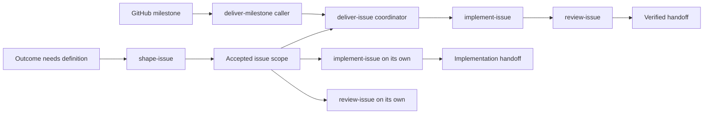

# Agent workflows

Shared skills, development procedures and engineering memory for independent projects. Pin the toolkit as a Git submodule and keep product rules in your project's `AGENTS.md`.

The goal is continuity: define bounded work, implement and review it, then retain useful evidence so another session or machine can continue. Projects can be monorepos or standalone applications and libraries.

Version tags and the changelog name stable release boundaries; consumers continue
to pin exact SHAs. See the [release versioning policy](docs/skill-distribution.md#release-versioning).

## Contents

- [How the pieces fit together](#how-the-pieces-fit-together)
- [Skills](#skills)
  - [shape-issue](#shape-issue)
  - [deliver-issue](#deliver-issue)
  - [deliver-milestone](#deliver-milestone)
  - [implement-issue](#implement-issue)
  - [review-issue](#review-issue)
  - [reconcile-issues-after-merge](#reconcile-issues-after-merge)
  - [cut-release](#cut-release)
  - [setup-agent-workflows](#setup-agent-workflows)
  - [setup-basic-memory](#setup-basic-memory)
  - [configure-mcp](#configure-mcp)
  - [update-agent-workflows](#update-agent-workflows)
  - [adopt-skills](#adopt-skills)
- [Development workflow](#development-workflow)
- [Harness-owned workspaces](#harness-owned-workspaces)
- [Memory system](#memory-system)
- [Install and set up](#install-and-set-up)
- [T3 Code worktree setup](#t3-code-worktree-setup)
- [Everyday use](#everyday-use)
- [Clone and update](#clone-and-update)
- [Local files and Git](#local-files-and-git)
- [Verification and references](#verification-and-references)

## How the pieces fit together

| Component | Responsibility | Provided by |
| --- | --- | --- |
| Skills | Instructions an agent loads for a specific task. | This repository's `.agents/skills`. |
| Development workflow | The sequence from issue definition through delivery, review and post-merge reconciliation. | The skills plus your project's rules. |
| Workspaces | Fresh-checkout setup only; the harness owns workspace binding and lifecycle. | [`docs/worktrees.md`](docs/worktrees.md) |
| Memory routing | Select project scope and retain development context. | The consumer's `.agents/memory/config.md`. |
| Capture and resume | Structure notes, save thread context and retrieve it later. | Basic Memory's own skills, installed by the project at its server's release. |
| MCP tools | Operations such as searching, reading and writing notes. | The connected Basic Memory service. |

A skill teaches the agent when and how to use a capability. An MCP tool performs an operation. Installing skills does not configure a client's MCP connection.

## Skills

The project workflow skills travel with the pinned submodule. Six cover issue work; the others cover collaboration, releases, project setup, memory setup, MCP configuration, routine updates, and third-party skill adoption. Basic Memory's own skills are installed from upstream by each memory-enabled project. Integration references stay consumer-owned and load on demand; the former `add-integration` and `use-integration` skills are retired — see the [integration reference guide](docs/integrations.md).

The issue skills have different scopes. Use `implement-issue` for a bounded change when the issue scope is already agreed. Use `deliver-issue` when you want the whole issue carried through planning, implementation, independent review and verified handoff. `deliver-issue` coordinates the implementation and review skills; it does not replace them. Use `shape-issue` first if the requested outcome still needs definition, or `review-issue` alone when you only need an independent review. `deliver-milestone` coordinates a GitHub milestone's issues, each delivered through a fresh `deliver-issue` coordinator.



Choose **deliver** for end-to-end coordination, **implement** for scoped coding work, and **review** for assessment without implementation. For a whole GitHub milestone, **deliver-milestone** assesses and schedules its issues, then coordinates each through a fresh `deliver-issue` child.

### `shape-issue`

Turn an outcome, bug or large feature into a bounded issue or linked issue drafts. Use it to clarify scope and acceptance criteria before implementation. It can draft locally without creating a tracker record.

**Example request:**
> “Shape an issue for inconsistent FAQ expansion behavior. Define acceptance criteria and split the work only if needed; leave it as a draft.”

[Read the skill](.agents/skills/shape-issue/SKILL.md).

### `deliver-issue`

Coordinate an accepted issue through a plan, bounded implementation, independent review and verified handoff. It orchestrates the delivery process using the separate implementation and review skills, within the client's available capabilities and delegation permissions.

**Example request:** 
> “Deliver issue #42 against its accepted criteria. Coordinate implementation and independent review, run this project's required checks, and leave a verified handoff.”

[Read the skill](.agents/skills/deliver-issue/SKILL.md).

### `deliver-milestone`

Assess a GitHub milestone's issues against current code and dependencies, agree one execution plan with the owner, then coordinate each issue through a fresh per-issue `deliver-issue` coordinator — launched on the optional `orchestrator` delivery-profile role — and report an evidence-based completion summary. Single issues stay on `deliver-issue`; neither entry point silently redirects the other's target.

**Example request:**
> "Deliver milestone v1.4. Assess its issues, propose the order, and coordinate delivery to verified PRs ready for merge."

[Read the skill](.agents/skills/deliver-milestone/SKILL.md).

### `implement-issue`

Implement a bounded issue or assigned slice whose scope is already established. Follow consumer product rules, make the required changes and report focused verification evidence. Use issue shaping first when the requested outcome still needs definition.

**Example request:** 
> “Implement the FAQ expansion slice of issue #42 using its agreed acceptance criteria. Run the focused checks and report any remaining limits.”

[Read the skill](.agents/skills/implement-issue/SKILL.md).

### `review-issue`

Independently review an implementation, PR or local diff against issue criteria, project boundaries and verification evidence. Report actionable findings and unmet criteria; this is a review task rather than an implementation request.

**Example request:** 
> “Review the local diff for issue #42 against its acceptance criteria and the recorded checks. Report findings without modifying the implementation.”

[Read the skill](.agents/skills/review-issue/SKILL.md).

### `reconcile-issues-after-merge`

After a verified merge, reconcile acceptance checklists, issue status, parent progress and dependencies against what actually landed. A merge alone does not establish that every referenced issue is complete. This skill is still maintained and installable; tracker edits follow existing authorization.

**Example request:** 
> “Reconcile the issues linked to merged PR #57. Identify completed criteria, remaining parent work and stale dependencies; propose tracker updates.”

[Read the skill](.agents/skills/reconcile-issues-after-merge/SKILL.md).

### `cut-release`

Classify merged changes, propose the version and dated changelog, and prepare an annotated tag plus readable GitHub Release notes. For GitHub projects, publication is the normal outcome; tag-only delivery remains available on request. Tagging, pushing and publishing require explicit approval of the concrete proposal, and existing release machinery takes precedence.

**Example request:**
> “Cut a release of this project. Account for changes since the last tag and the previous published release, propose the version, and show me the tag annotation, release notes and commands for approval.”

[Read the skill](.agents/skills/cut-release/SKILL.md).

### `setup-agent-workflows`

Inspect a consumer and install selected shared capabilities, apply shared policies, discover required checks, and verify installation. When no memory choice is established, it offers Basic Memory as an option; declining finishes issue-only setup without MCP access or memory configuration. If selected, it invokes the separate memory setup skill. Routine library refreshes use `update-agent-workflows`; detected legacy state gets a specific migration handoff.

**Example request:** 
> “Set up the issue workflow skills in this checkout, then ask whether I want Basic Memory.”

[Read the skill](.agents/skills/setup-agent-workflows/SKILL.md).

### `setup-basic-memory`

Configure or verify local Basic Memory routing after workflow installation, or invoke it later for an existing consumer. It reports local installation separately from MCP and schema readiness, respects existing routing and client settings, and requires existing write authorization before schema creation.

**Example request:**
> “Use setup-basic-memory to configure this existing consumer from our reviewed routing choices and check which schemas are available.”

[Read the skill](.agents/skills/setup-basic-memory/SKILL.md).

### `configure-mcp`

Check which MCP services a project declares in `.agents/mcp-requirements.json` and how the Claude, Codex and OpenCode project configuration covers them on this machine — and, only after explicit owner confirmation of a reviewed redacted plan, apply the bounded edits that align the selected services. The check path is the default and writes nothing; the setup path reuses matching registrations under their existing names, refuses conflicts without a recorded resolution, re-verifies every destination before writing, and never copies credential values. Unlike `setup-basic-memory`, which drives Basic Memory's profile-driven routing flow, `configure-mcp` covers the general service set declared by the [MCP requirements manifest](docs/mcp-requirements.md).

**Example request:**
> "Check this project's MCP requirements and align the selected services with Claude, Codex and OpenCode on this machine."

[Read the skill](.agents/skills/configure-mcp/SKILL.md). Migration and onboarding — including tracked client files becoming consumer-owned, deselection and rollback, and two-machine setup — is covered by [docs/mcp-configure-migration.md](docs/mcp-configure-migration.md).

### `update-agent-workflows`

Adopt an explicitly reviewed shared-library revision and refresh an existing
consumer's selected installation. It inspects the pin, worktree state,
customizations and routing, then uses the applicable install helper and
consumer checks. It preserves local overrides and stops on dirty/diverged
submodules or policy conflicts. It does not perform initial setup or write
memory schemas.

The install flags and follow-up commands come from a read-only plan on the
pinned dispatcher, which a person can also run without an agent. It writes,
stages and checks out nothing, fetches only a requested `--target` from the
recorded submodule URL, and exits nonzero when the checkout must stop for
the owner:

```sh
node .agent-workflows/bin/agent-workflows.ts update plan --json
```

Approving the exact target and planned changes authorizes the refresh and a
scoped commit of the gitlink plus tracked refresh changes; the update then
lands through the consumer's authorized path — a pull request where its rules
require one, a direct push only where permitted and owner-authorized. An
explicit local-only request leaves the result uncommitted for inspection.
The handoff reports the update landed only after the remote target branch
records the new pin.

**Example request:**
> “Use update-agent-workflows to refresh this checkout to the reviewed library commit `<sha>`. Preserve our local overrides and recorded choices, reconcile the derived toolkit for review, and run the documented consumer checks.”

[Read the skill](.agents/skills/update-agent-workflows/SKILL.md).

### `adopt-skills`

Consolidate third-party skills installed by a vendor tool (for example `npx skills add …`) from per-harness copies into a single `.agents/skills/<name>`, linking every harness folder that cannot read `.agents/skills` natively. Adoption plans as a dry run until confirmed, refuses differing copies and toolkit name clashes, detects drift after vendor re-installs, and records provenance in `.agents/adopted-skills.json`. The skill never runs vendor installers.

**Example request:**
> “Adopt the skills I just installed into `.claude/skills` and `.codex/skills` so they live in one place.”

[Read the skill](.agents/skills/adopt-skills/SKILL.md).

### Basic Memory's own skills

`memory-notes`, `memory-capture`, `memory-continue` and `memory-schema` come from the Basic Memory project, not from this library. A memory-enabled project installs them itself at the release that matches its server. See [installing Basic Memory's skills](docs/memory/upstream-skills.md).

## Development workflow

A typical issue moves through these steps:


The skills stay separate so you can define an issue without implementing it, request a review without changing code, or reconcile a merge without repeating review. Delivery can loop through implementation and review when findings require another change.

GitHub Issues remains the delivery tracker. Your project's `AGENTS.md`, context and engineering docs govern product architecture, commands and authorization. Installing these workflows does not authorize tracker edits, deployment, remote data changes or messages.

Consumers declare required lint/format checks in their existing `AGENTS.md` or engineering documentation, referencing tooling configuration for commands and scope. See [consumer check guidance](docs/consumer-checks.md) for discovery, role responsibilities, and verification evidence. No additional tool or tracker is required. Consumers using the GitHub issue skills need configured `gh` access; this is documented in [integration guidance](docs/integrations.md), not imposed on other workflows.

Optional Codex profiles live in `.codex/agents`: the implementation profile defaults to Luna medium and the review profile to Sol medium. The coordinator's model is chosen by the consumer. A consumer can also pin per-role provider, model and reasoning in an optional `.agents/delivery-profiles.json`, and a guided interactive flow can choose and verify the values from live harness capabilities; see [delivery profiles](docs/delivery-profiles.md). Installed profiles alone do not prove discovery, model selection or independent review.

## Harness-owned workspaces

The harness owns workspace binding and worktree paths, creation, relocation and
cleanup. Agents follow the active checkout and preserve existing work. See the
[fresh checkout guidance](docs/worktrees.md) for the separate readiness steps:
initialize the consumer's pinned submodules, install its derived toolkit and
profiles, then configure optional local routing if enabled.

An update removes only the exact recognized legacy worktree policy block from
the consumer's `AGENTS.md`. Custom, malformed or duplicate blocks require a
reviewed edit. Updating a library pin alone does not remove an already embedded
block; run the consumer's selected installation refresh.

## Memory system

We use **Basic Memory's native MCP tools and its own capture/resume skills**, installed from upstream at the server's release. The project supplies a small routing policy: where to write, which projects to read, and how to treat historical development evidence.

[Basic Memory](https://docs.basicmemory.com/start-here/what-is-basic-memory) stores Markdown notes and indexes them. Tool names and arguments depend on the server's release, and old names are removed without aliases, so check the deployed tool schemas rather than assuming a name. See the [compatibility contract](docs/memory/compatibility.md) and upstream's [tool reference](https://docs.basicmemory.com/reference/mcp-tools-reference).

Linux, Mac and other clients can create and retrieve the same notes by connecting to the **same service and project**. They need independent working client connections and network access, but no NAS mount.

A handoff is a coherent thread note: what was learned or decided, observed checks, uncertainty, remaining work and useful source references. Recapture reads and updates that thread note to reflect current understanding. At resume, the agent retrieves it and compares its context with the current checkout. Code still travels through Git; memory travels through MCP.

Our previous custom verification runner, Stop hook, milestone fence, immutable checkpoint workflow, local receipt queue and replay engine are retired. The [native lifecycle guide](docs/memory/lifecycle-guide.md) explains the simpler flow with examples. Existing consumers must follow the [migration guide](docs/memory/migration.md) before adopting this revision; old custom hooks call scripts that have been removed.

Ordinary captures write to the configured project. Read that project first, then shared-engineering when relevant; related projects require a task-specific reason. Shared lessons retain source references. GitHub Issues remains the tracker, and memory grants no authorization. If MCP is unavailable, report the summary as unsaved in the session handoff. Inspect an uncertain write before retrying; there is no custom queue or automatic replay.

## Install and set up

A **consumer** is the project checkout using this library. It needs a root `AGENTS.md` and Git. A native MCP connection to Basic Memory is needed only when configuring or using memory workflows. Node.js 22.18+ runs setup and library validation. No custom memory service or hook is installed.

### 1. Add the library and install the versioned toolkit

From the consumer root, set `library_sha` to the reviewed release commit that
you want to pin. Then run:

```bash
git submodule add https://github.com/AndreaBarghigiani/agent-workflows.git .agent-workflows
git -C .agent-workflows checkout --no-overwrite-ignore --detach "$library_sha"
git add .agent-workflows
node .agent-workflows/bin/agent-workflows.ts install --project . \
  --memory declined
```

For an existing installation, use the [update procedure](#clone-and-update). The
installer derives the standard toolkit from the pinned library version — there
is no `--skills` selection; the helper rejects the removed option with
migration guidance. Record the Basic Memory choice with `--memory enabled` or
`--memory declined`; it is stored in
`.agent-workflows-capabilities.json`, and an unknown choice installs the
issue-only toolkit without enabling memory. The installer exposes relative
links under `.agents/skills`, maintains the reference-only pointer block in
root `AGENTS.md`, and adds collaboration guidance to root `AGENTS.md`. Local
conflicts are refused and regular Codex agent overrides preserved. When the
library is a registered submodule, the installer keeps it detached at the
recorded pin: a clean attached checkout at the pin is detached in place (the
branch is preserved), while dirty files, an unstaged pin difference or local
commits stop the run for review. A standalone or copied library checkout
keeps its state. See the
[toolkit contract](docs/skill-distribution.md).

Claude Code reads project skills only from `.claude/skills`. Add `--claude-skills` to mirror the same toolkit there (opt-in, idempotent). For instruction loading and the upgrade path for existing consumers, see [Claude Code setup](docs/claude.md).

OpenCode discovers the same `.agents/skills` installation. Add `--codex-agents` if you want the Codex profiles. See [OpenCode setup](docs/opencode.md) for
native MCP registration, session reload, discovery checks and project routing.
Codex MCP setup is in [Codex setup](docs/codex.md). Devin runs through T3 Code's ACP integration; see [Devin setup](docs/devin.md). Grok delegates run through T3's provider integration; see [Grok setup](docs/grok.md). Antigravity Gemini delegates run through T3's Antigravity ACP integration; see [Antigravity setup](docs/antigravity.md). The Codex, Claude Code, OpenCode, Devin, Grok and Antigravity guides follow the
shared [connection reference](.agents/skills/setup-basic-memory/references/client-connection.md).

### 2. Optionally configure native memory

Review the project identity, scopes and client server name in a [v2 example](docs/memory/examples), then run:

```bash
node .agent-workflows/bin/agent-workflows.ts setup_memory --project . \
  --portable <reviewed-config.toml>
node .agent-workflows/bin/agent-workflows.ts setup_memory --project . --check
```

Run this only when Basic Memory is selected or added later. Setup links `setup-basic-memory`; install Basic Memory's own skills separately, [pinned to the server's release](docs/memory/upstream-skills.md). Inspect and read back the `Decision` and `Pattern` schema notes when MCP is available. Creating a missing schema is a remote write and requires existing explicit write authorization for that Basic Memory project; routing alone does not authorize it. If MCP or write authorization is unavailable, report memory readiness as incomplete while retaining the valid workflow installation. The `setup_memory.ts` script writes local routing and instructions under `.agents/memory/` and adds a reference in `AGENTS.md`. It does not install worktree lifecycle policy or access Basic Memory. Omit `--portable` once configuration exists. Customized instructions or differing routing require a reviewed edit.

Generated instructions tell agents to use the configured project scopes without
asking for project selection again. Updating from the previous unmodified v2
instructions adds this guidance on the next setup run; `--check` identifies the
stale file and never edits anything. Customized instructions stay protected.
Check failures in both helpers name the missing, stale, customized or
conflicting artifact and either print a deterministic repair command or
identify the reviewed input still needed; a local check failure is not evidence
about memory connectivity.

Local setup files stay uncommitted until the user stages them. Authorized schema setup does not overwrite existing project schemas. `--share-config` skips adding the memory-directory ignore but never removes existing ignore rules or stages files. Setup preserves existing issue skills and connects clients only through the explicitly enabled project-connection option. It never authenticates, deploys a server or installs hooks.

Optionally, a reviewed `[connection] clients = [...]` routing table makes
setup render git-ignored project-scope connection files (`.mcp.json`,
`.codex/config.toml`, `opencode.json`) from a machine-local profile holding
the endpoint and a credential env-var name — never a value — so memory works
in every checkout and worktree without editing home-folder client config.
`setup_memory_connections.ts` regenerates them per checkout and composes into
the T3 worktree setup action. See [project-scope client connections](docs/memory/connections.md).

### T3 Code worktree setup

T3 setup is a separate opt-in for new and existing consumers. It does not
change the library pin or selected installation. See the [worktree setup
guide](docs/t3-checkout-readiness.md) for explicit consumer configuration,
read-only checks and manual action import. Declining requires no T3 connection.

For memory configuration, ask: “Read `.agent-workflows/.agents/skills/setup-basic-memory/SKILL.md` and configure Basic Memory in this checkout.” This works before the skill is linked. Verify actual skill discovery and native MCP access in each client; a setup check only verifies local artifacts. If the memory option is declined, no memory helper or MCP check is needed.

## Everyday use

- “Use memory-capture to save where this task landed, including checks, uncertainty and next action.”
- “Use memory-continue to resume this issue from its relevant note and compare it with this checkout.”
- “Use memory-notes to record this decision with its rationale and sources.”

The agent can capture meaningful progress during the task or at handoff using native tools. There is no automatic Stop registration, required evidence wrapper or milestone JSON block. See the [lifecycle examples](docs/memory/lifecycle-guide.md).

## Clone and update

Initialize the library commit pinned by a consumer:

```bash
git clone --recurse-submodules <consumer-repository-url>
# Or in an existing clone:
git submodule update --init --recursive
```

To adopt another reviewed revision, use
[`update-agent-workflows`](.agents/skills/update-agent-workflows/SKILL.md) to
inspect the consumer and resolve the target. It compares installed managed
policy with the old and new templates, refreshes only selected assets, runs
the applicable drift and consumer checks, and lands the new pin through the
consumer's authorized commit and push or pull-request path unless a local-only
trial is requested. For an existing installation whose
pin predates this skill, resolve the requested target, fetch it if needed, and
read the destination skill and reference from that commit before adoption. A
fetch makes it inspectable; it does not by itself authorize adopting it:

```bash
git -C .agent-workflows show <target-sha>:.agents/skills/update-agent-workflows/SKILL.md
```

The destination skill is not present at the old pin. These commands inspect
the conventional library path before resolving or changing the pin:

```bash
git -C .agent-workflows status --short
git -C .agent-workflows remote -v
git -C .agent-workflows rev-parse HEAD
```

**For existing custom-memory consumers, retire the old hooks and review unresolved local captures before changing the pin.** Follow [migration](docs/memory/migration.md); the new setup refuses detected legacy project registrations or policy rather than silently discarding them.

Issue-only consumers refresh and check the derived toolkit with
`install.ts` and `--check`; never pass the removed `--skills` option. A refresh
also retires proven toolkit-owned links and exact copies of skills the pinned
revision removed — currently `add-integration` and `use-integration` — while
same-name content it cannot prove is preserved and reported; see the
[integration reference guide](docs/integrations.md#retired-integration-skills).
When the
memory choice changes, record it explicitly with `--memory enabled|declined`.
Memory-enabled consumers can use
`setup_memory.ts` only when the consumer root has its own `.agent-workflows`
submodule and a recorded `enabled` choice; run its
`--check` after refresh. No memory config means initial setup is needed, not a failed Git
update. Each worktree has its own configuration and skill links. On another
machine, pull the consumer repository's pinned submodule update, initialize it,
configure local routing and connect the client to the same Basic Memory
service. Routine updates do not create or change schema notes. Avoid automatic
`--remote` updates.

## Local files and Git

| Location | Purpose | Treatment |
| --- | --- | --- |
| `.agent-workflows` | Reviewed library pin. | Track the gitlink to share the revision; the update's scoped commit records it. |
| `.agents/delivery-profiles.json` | Optional consumer-owned delivery model profiles; created empty only on explicit opt-in. | User chooses what to track or ignore; preserved byte-for-byte by install and update. |
| `.agents/mcp-requirements.json` | Optional consumer-owned [MCP service requirements](docs/mcp-requirements.md); consumer-authored, never created or populated by the toolkit. | User chooses what to track or ignore; preserved byte-for-byte by install and update. |
| `.agents/skills/`, `.codex/agents/` | Selected links and optional profiles. | User chooses what to track or ignore; preserve overrides. |
| `.agents/memory/config.toml` | Project routing and native client server name. | Ignored by default; user may choose to share. |
| `.agents/memory/config.md` | Local memory instructions. | Same memory-directory choice. |
| `AGENTS.md` | Consumer rules, collaboration guidance and optional memory reference. | Tracked edits stay visible to Git. |
| Generated memory connection entries | Opted-in Claude, Codex and OpenCode project connections. | Ignored; generated from the machine profile, preserving unrelated settings. |
| `.agents/memory/connections.json` | Ownership of helper-written entries. | Ignored; helper-managed, never evidence of permission for remote writes. |
| Machine connection profile | Endpoint and authentication variable name. | Owner-managed outside the checkout; never committed. |
| Client MCP settings | Connection and authentication. | Managed locally by the client; without the project-connection opt-in, the install and memory helpers never edit them. `setup-basic-memory` changes one only with explicit authorization. |

`.gitignore` only affects untracked files. Setup never stages or commits. Shared notes persist in Basic Memory, not the consumer repository. Existing old queues and evidence are retained for reviewed migration, not used by the native flow.

## Verification and references

- [Native capture/resume examples](docs/memory/lifecycle-guide.md)
- [Configuration contract](docs/memory/configuration.md) and [project policy](docs/memory/policy.md)
- [Migration from custom memory](docs/memory/migration.md)
- [Basic Memory 1.0 compatibility contract](docs/memory/compatibility.md)
- [Installing Basic Memory's skills](docs/memory/upstream-skills.md)
- [Updating a memory-enabled consumer, and going back](docs/memory/consumer-update.md)

## Licence

Agent Workflows is available under the [MIT License](LICENSE). The bundled
`smol-toml` parser retains its [BSD 3-Clause licence](scripts/vendor/smol-toml/LICENSE).

Early workflow ideas drew on Matt Pocock’s skills and pstack.
